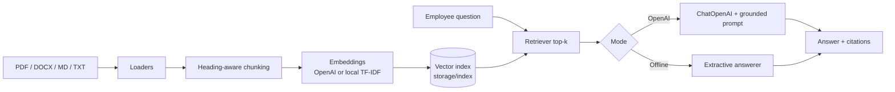

# Enterprise RAG Knowledge Assistant

A Retrieval-Augmented Generation (RAG) assistant that answers employee questions from
company documents such as HR policies, finance and expense manuals, IT security policies
and FAQs. Every answer is grounded in the indexed documents and cites its sources.
Questions the documents don't cover are declined instead of answered with made-up facts.

**Stack:** Python · LangChain · OpenAI · Gradio

[](https://github.com/kishore774477/enterprise-rag-knowledge-assistant/actions/workflows/tests.yml)

## Features

- **Chat UI (Gradio)** with inline citations `[1]`, a panel showing the retrieved passages and their relevance, and follow-up questions that use the conversation history.
- **Multi-format ingestion:** PDF, DOCX, Markdown and TXT. Markdown is split by heading, so every chunk knows its section (for example *HR Policy Handbook > Leave Policy > Sick Leave*).
- **Knowledge base management:** upload, remove and re-index documents from the browser.
- **Two modes:**
  - **OpenAI mode:** OpenAI embeddings plus a chat model that writes the answer from the retrieved context (LangChain LCEL chain).
  - **Offline mode:** used when no API key is set. Local TF-IDF hashing embeddings plus an extractive answerer, so the project runs on any laptop at no cost. If OpenAI is unreachable or the key is invalid, the app switches to offline mode by itself and tells you.
- **Built-in evaluation:** retrieval hit rate, MRR, answer keyword recall and refusal accuracy on a labelled question set, available from the CLI or the UI.
- **Tests and CI:** pytest suite covering ingestion, retrieval, answers, uploads, evaluation and the OpenAI fallback, run on every push by GitHub Actions.

## Architecture



## Quick start (Windows PowerShell)

Requires Python 3.10 or newer (tested on 3.12, 3.13 and 3.14).

```powershell
git clone https://github.com/kishore774477/enterprise-rag-knowledge-assistant.git
cd enterprise-rag-knowledge-assistant
.\setup.ps1
.\.venv\Scripts\Activate.ps1
python app.py
```

Then open http://127.0.0.1:7860. The index is built automatically on first launch.

`setup.ps1` creates the `.venv` environment from a real Python installation and installs
the dependencies. It ignores any other project's environment that happens to be active, and
rebuilds `.venv` by itself if it is broken. Options: `-Force` always rebuilds, and
`-Python 3.13` picks a specific Python version. If PowerShell says running scripts is
disabled, use `powershell -ExecutionPolicy Bypass -File .\setup.ps1`.

**Manual setup (macOS, Linux, or without the script):** first run `deactivate` if another
virtual environment is active, then:

```bash
python -m venv .venv
source .venv/bin/activate        # Windows: .\.venv\Scripts\Activate.ps1
pip install -r requirements.txt
python app.py
```

### Use OpenAI (optional)

```powershell
Copy-Item .env.example .env
```

Put your key in `.env` (`OPENAI_API_KEY=sk-...`) and restart the app. The chat and embedding
models can be changed there too (`OPENAI_CHAT_MODEL`, `OPENAI_EMBEDDING_MODEL`). Each mode
keeps its own index under `storage/index/<mode>/`.

## Troubleshooting

**`ImportError: Importing the numpy C-extensions failed` / `No module named 'numpy._core._multiarray_umath'`**
or the app says *"Environment problem: ... cannot be loaded by Python 3.x"*.

The `.venv` folder was created with one Python version and its packages were installed with
another. This usually happens when `python -m venv .venv` is run while a different project's
environment is active: the new `.venv` gets that Python, but pip sees the old packages and
skips reinstalling them ("Requirement already satisfied"). Fix it by rebuilding:

```powershell
.\setup.ps1 -Force
```

Close the running app first, and run `deactivate` if `(.venv)` is shown in your prompt.

**Port 7860 is already in use:** start the app on another port with `python app.py --port 7861`.

## Command-line tools

| Command | What it does |
|---|---|
| `python app.py [--port 7860] [--share]` | Start the web app |
| `python ingest.py [--docs FOLDER]` | Rebuild the index from a documents folder |
| `python evaluate.py [-v]` | Run the evaluation and save `reports/eval_report.json` |
| `pytest -q` | Run the tests |

## Evaluation

`data/eval/qa_dataset.json` holds 28 labelled questions: 24 answerable ones across the four
sample documents and 4 out-of-scope ones that the assistant should decline.

| Metric | Offline mode |
|---|---|
| Retrieval hit rate (correct document in top 4) | 100.0% |
| MRR | 100.0% |
| Answer keyword recall | 95.8% |
| Refusal accuracy (out-of-scope questions) | 100.0% |
| **Overall score** | **98.2%** |

The overall score averages, per question, `0.5 × retrieval hit + 0.5 × keyword recall` for
answerable questions and `1 if correctly declined` for out-of-scope ones. The one miss in
offline mode is *"What is the minimum password length?"*: the policy says "at least 12
characters long", and keyword matching can't link "minimum length" to that wording. Semantic
OpenAI embeddings are built for that kind of paraphrase. Run `python evaluate.py` with a key
set to measure OpenAI mode on your own account.

## Project structure

```
├── app.py                  # Gradio web UI
├── ingest.py               # CLI: build the index
├── evaluate.py             # CLI: run the evaluation
├── setup.ps1               # Windows: create or repair .venv and install dependencies
├── envcheck.py             # clear error message when the environment is broken
├── rag/
│   ├── config.py           # settings from .env / environment
│   ├── loaders.py          # PDF/DOCX/MD/TXT loading + chunking
│   ├── embeddings.py       # OpenAI + offline TF-IDF hashing embeddings
│   ├── knowledge_base.py   # build / persist / load / search the vector index
│   ├── assistant.py        # retrieval + grounded answer generation
│   ├── evaluation.py       # metrics
│   └── text.py             # tokenizer, stemmer, sentence splitter
├── data/
│   ├── documents/          # sample company documents (replace with your own)
│   └── eval/qa_dataset.json
└── tests/
```

## Using your own documents

Drop files into `data/documents/` and run `python ingest.py`, or upload them from the
**Knowledge base** tab. Update `data/eval/qa_dataset.json` with questions about your
documents to measure quality.

The sample documents describe a fictional company, *Orion Dynamics Ltd.*, and are for
demonstration only.
